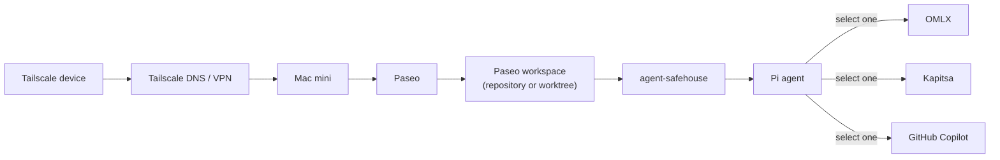
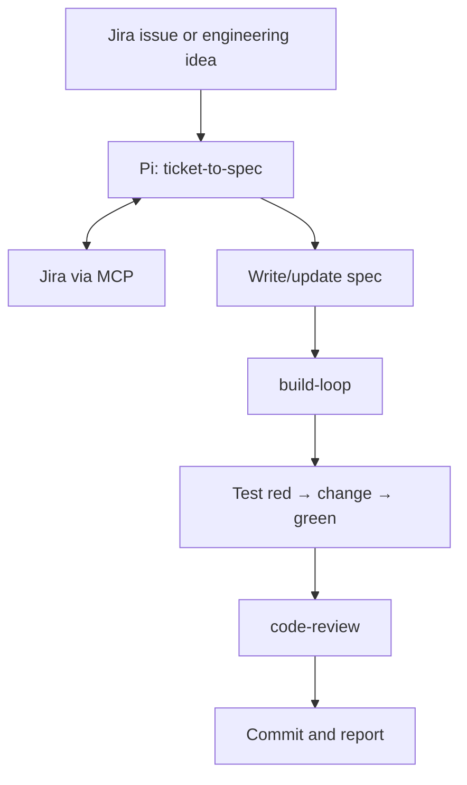

# Architecture

## Network and workspace

**Paseo setup:** Register the repository on the mini, create a local or worktree workspace per task, then launch Pi through `agent-safehouse`. Ensure Paseo can resolve the wrapper defined in `.zshrc`.

**Providers:** GitHub Copilot is this harness's default. Configure OMLX or Kapitsa on the mini before selecting it in Pi.

## Jira and engineering flow

Configure the Jira MCP server as `jira`; keep credentials private. New Jira issues require confirmation.
