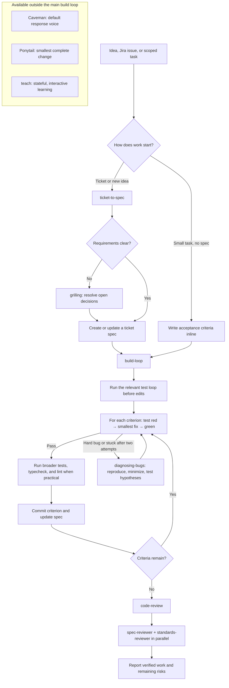

# Engineering Agent Harness

[Architecture: network, Paseo workspaces, providers, and Jira workflow](ARCHITECTURE.md)

This repository is a **Pi coding-agent configuration**, not a standalone application. Point Pi at `agent/` to load the shared instructions, skills, reviewer profiles, subagent tool, and default settings while working in another repository.

## What it provides

- **Pi settings** in `agent/settings.json`: GitHub Copilot as the default provider, hidden thinking blocks, and the Ponytail package pinned to `v5.3.3`.
- **Shared instructions** in `agent/AGENTS.md`: Caveman is the default response voice; `stop caveman` turns it off for the session, and `normal mode` turns off Caveman and Ponytail for the session.
- **Skills** in `agent/skills/`: repeatable engineering and learning workflows (listed below).
- **Reviewer agents** in `agent/agents/`: read-only spec and standards reviewers.
- **Subagent extension** in `agent/extensions/subagent/`: a `subagent` tool for isolated single, parallel, or chained Pi tasks.

Pi discovers `AGENTS.md`, skills, and extensions from its agent directory. The subagent extension discovers the reviewer profiles from that same directory's `agents/` folder. This setup keeps the harness reusable across projects without copying its files into each project.

## Intended engineering workflow



A small task can skip a written spec if its acceptance criteria are stated up front. Ticket work normally starts with `ticket-to-spec`; it asks before creating a Jira issue, and it writes a testable spec for `build-loop`. The build loop works one acceptance criterion at a time and commits each completed criterion. Use `diagnosing-bugs` when a failure needs a disciplined reproduction loop. Finish with `code-review` when a spec and/or standards review is useful.

## Skills

| Skill | Use it for |
|---|---|
| `ticket-to-spec` | Fetch a Jira issue or shape a new idea into a Jira-linked `specs/<KEY>.md`. It uses the `grilling` skill to close gaps when needed. New Jira issues require confirmation. |
| `grilling` | Explore decisions as a structured question tree. Once the user confirms the shared understanding, write the decisions and acceptance criteria to a spec. |
| `build-loop` | Implement a spec test-first: establish a baseline, then red → green → widen checks → commit for each acceptance criterion. |
| `diagnosing-bugs` | Build and run a tight feedback loop, reproduce and minimize the issue, rank falsifiable hypotheses, test a regression, and clean up instrumentation. A human-run template is available for bugs that require clicks. |
| `code-review` | Review a change from a supplied fixed point on two separate axes: spec fidelity and repository standards. It delegates to the two read-only reviewer agents. |
| `caveman` | Keep answers terse without dropping technical facts. Active by default through `agent/AGENTS.md`; `stop caveman` disables it for the current session. |
| `teach` | Teach a topic through lessons and learning records. If the current directory is a code repo rather than a dedicated learning workspace, it asks for a separate folder before writing there. |

Skills are available as `/skill:<name>` commands when loaded. Examples:

```text
/skill:ticket-to-spec DDM-123
/skill:build-loop specs/DDM-123.md
/skill:diagnosing-bugs
/skill:code-review main
```

The `code-review` and `teach` skills are explicit-invocation skills. The other skills can also be selected automatically from a matching request.

### Reviewer agents

- **`spec-reviewer`** checks the supplied diff against the supplied issue/spec. It reports missing or partial requirements, unrequested behavior, and likely implementation mistakes.
- **`standards-reviewer`** checks the supplied diff against supplied repository standards and code-smell heuristics.

Both profiles are read-only and have only `read`, `grep`, `find`, and `ls` tools. `code-review` runs them in separate subagents and reports their findings side by side. The subagent extension starts child Pi processes with `--no-mcp`, so delegated agents do not inherit MCP tools.

### Subagent tool

The `subagent` extension supports:

- **Single:** delegate one task to one named agent.
- **Parallel:** run independent tasks against separate isolated contexts.
- **Chain:** run agents sequentially and insert earlier output with `{previous}`.

By default, the tool discovers user-level agents. It can also discover trusted project-local agents when asked. Project-local agents are repository-controlled code/instructions; only approve them for repositories you trust.

## Setup for a new user

### 1. Install Pi

On macOS or Linux, install the Pi CLI with the official installer:

```bash
curl -fsSL https://pi.dev/install.sh | sh
```

Verify it is on your `PATH`:

```bash
pi --version
```

Alternatively, install from npm with Node.js `22.19` or newer:

```bash
npm install -g --ignore-scripts @earendil-works/pi-coding-agent
```

On Windows, use the [Pi Windows setup guide](https://github.com/earendil-works/pi/blob/main/docs/windows.md). Pi also needs `git` available because this configuration installs the pinned Ponytail package from Git on first use.

### 2. Get this repository

Clone the repository using your organization's URL, or use a checkout you already have:

```bash
git clone <repository-url> "$HOME/src/agent-harness"
cd "$HOME/src/agent-harness"
```

Replace `<repository-url>` with the URL for this repository. Do not clone the harness over an existing `~/.pi/agent` directory.

### 3. Point Pi at the harness

For the current terminal session on macOS or Linux, set the agent directory to the checkout's `agent/` folder:

```bash
export PI_CODING_AGENT_DIR="$PWD/agent"
```

Keep this variable set when you start Pi from a different project. For a one-command launch, run this from the target project instead:

```bash
PI_CODING_AGENT_DIR="$HOME/src/agent-harness/agent" pi
```

To make the setting persistent, add the following line to `~/.zshrc` (zsh) or `~/.bashrc` (bash), replacing the path if you cloned elsewhere:

```bash
export PI_CODING_AGENT_DIR="$HOME/src/agent-harness/agent"
```

Then open a new terminal or source the matching file. This makes the harness the agent configuration for every `pi` command in that shell environment. If you want to keep your existing Pi configuration as the default, use the one-command launch instead.

In PowerShell, set the variable for the current terminal and start Pi with:

```powershell
$env:PI_CODING_AGENT_DIR = "$HOME\src\agent-harness\agent"
pi
```

### 4. Start Pi in the project you want to work on

Change to the target code repository, then launch Pi with the configured environment:

```bash
cd /path/to/your/project
pi
```

On first startup, Pi may need network access to install the Ponytail package pinned in `agent/settings.json`. Review and trust project-local resources only for repositories you trust. Extensions run with the permissions of the Pi process; project trust is not a sandbox.

### 5. Sign in to a model provider

The harness sets `github-copilot` as the default provider. In Pi, run:

```text
/login
```

Choose GitHub Copilot and follow its sign-in flow. Your account must have access to the selected model. Use `/model` to select another available model if needed. The config sets high thinking for `github-copilot/gpt-6-luna` when that model is available; it does not grant model access.

Because `PI_CODING_AGENT_DIR` points into this checkout, Pi stores this configuration's credentials, trust decisions, and sessions under `agent/`. The repository ignores those runtime files, including MCP OAuth credentials, but keep them private and check `git status` before committing. Do not add secrets to tracked files.

### 6. Confirm resources loaded

At startup, check Pi's resource messages for skills and the `subagent` extension, or open the `/` command menu to see the loaded skills. With a real spec, verify an explicit skill command such as:

```text
/skill:build-loop specs/<KEY>.md
```

If you add or edit skills, instructions, or extensions while Pi is running, use `/reload`. Startup or reload warnings usually identify missing packages or invalid skill files.

### 7. Configure Jira only if you need ticket workflows

This repository does not include Jira credentials or an MCP server configuration. Configure your organization's approved Jira MCP server in this agent directory (for example, run `pi mcp add` while `PI_CODING_AGENT_DIR` points to `agent/`), then verify the connection with:

```bash
pi mcp list
```

The `ticket-to-spec` skill expects a server named `jira` with the issue and comment tools it references. It currently allows Jira projects `DDM` and `IDP`. Without Jira MCP, you can still write a spec directly and use `build-loop` on it. Keep MCP configuration and OAuth credentials private; see the [Pi MCP guide](https://github.com/earendil-works/pi/blob/main/docs/mcp.md).

## Configuration and safety notes

- `agent/settings.json` pins `git:github.com/DietrichGebert/ponytail@v5.3.3`, sets `github-copilot` as the default provider, hides thinking blocks, and sets one model-specific thinking level.
- The custom `subagent` tool starts separate Pi processes with isolated session context and no MCP access. It limits parallel dispatch and reports failed child processes as failures.
- Extensions execute with the permissions of Pi. Review extension code before loading it, and use the harness only with trusted repositories and resources.
- Local runtime files such as `auth.json`, `mcp.json`, `mcp-auth.json`, trust data, and sessions are not part of the shared configuration. Keep secrets out of Git.
- This repository packages agent configuration; it does not define a product build or test command. `build-loop` discovers and runs checks from the target repository.

## Repository map

```text
agent/
├── AGENTS.md                         # Shared instructions and default voice
├── settings.json                     # Pi settings and pinned Ponytail package
├── agents/                           # Read-only spec and standards reviewers
├── extensions/subagent/              # Subagent tool and agent discovery
└── skills/                           # Engineering and teaching workflows
    ├── build-loop/
    ├── caveman/
    ├── code-review/
    ├── diagnosing-bugs/
    ├── grilling/
    ├── teach/
    └── ticket-to-spec/
```
